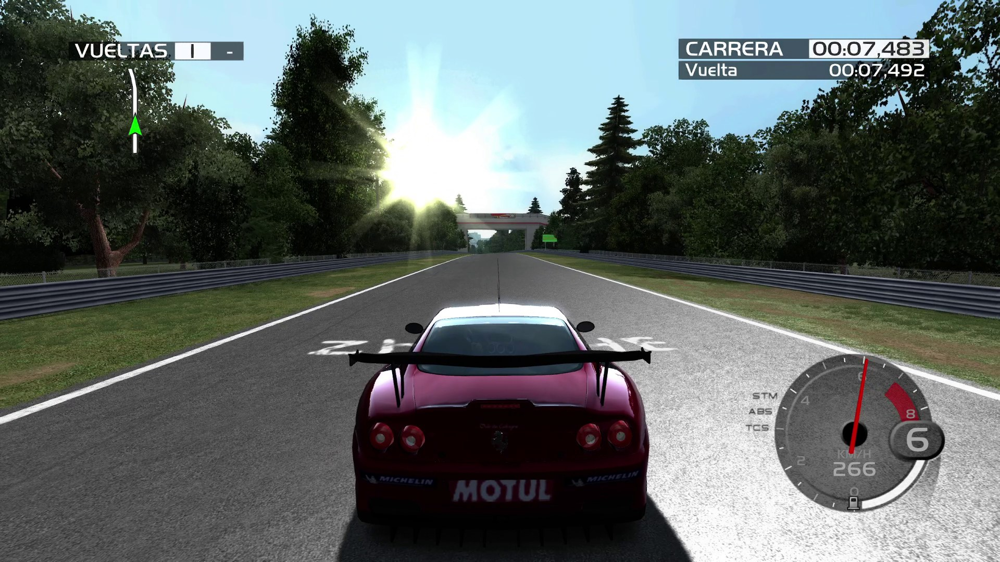
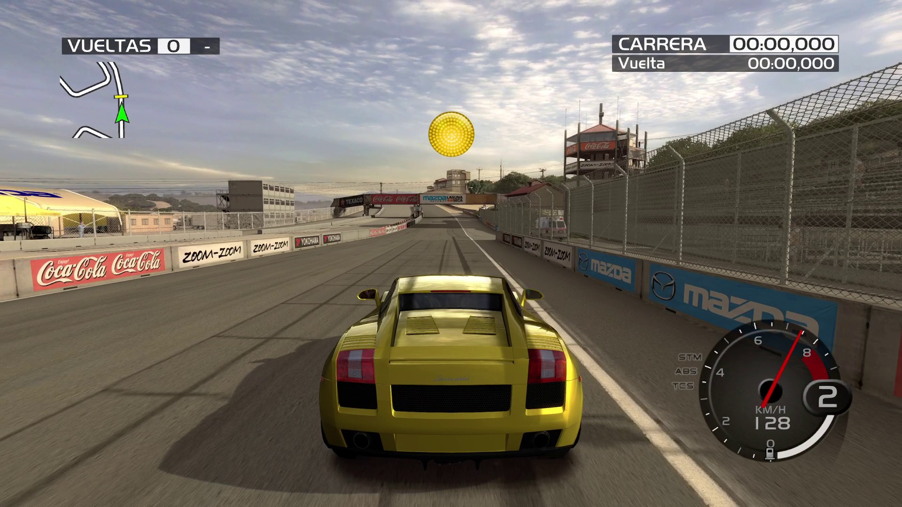
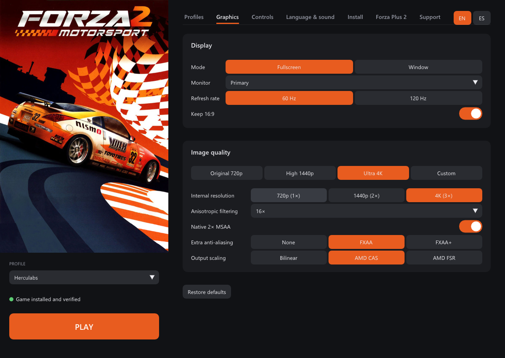
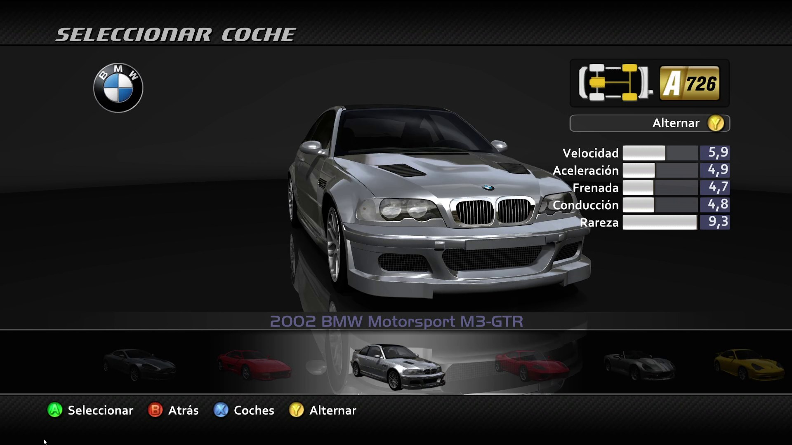
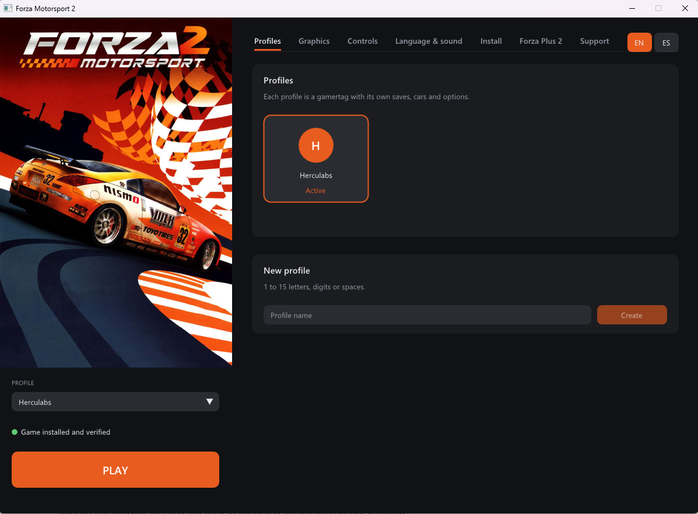
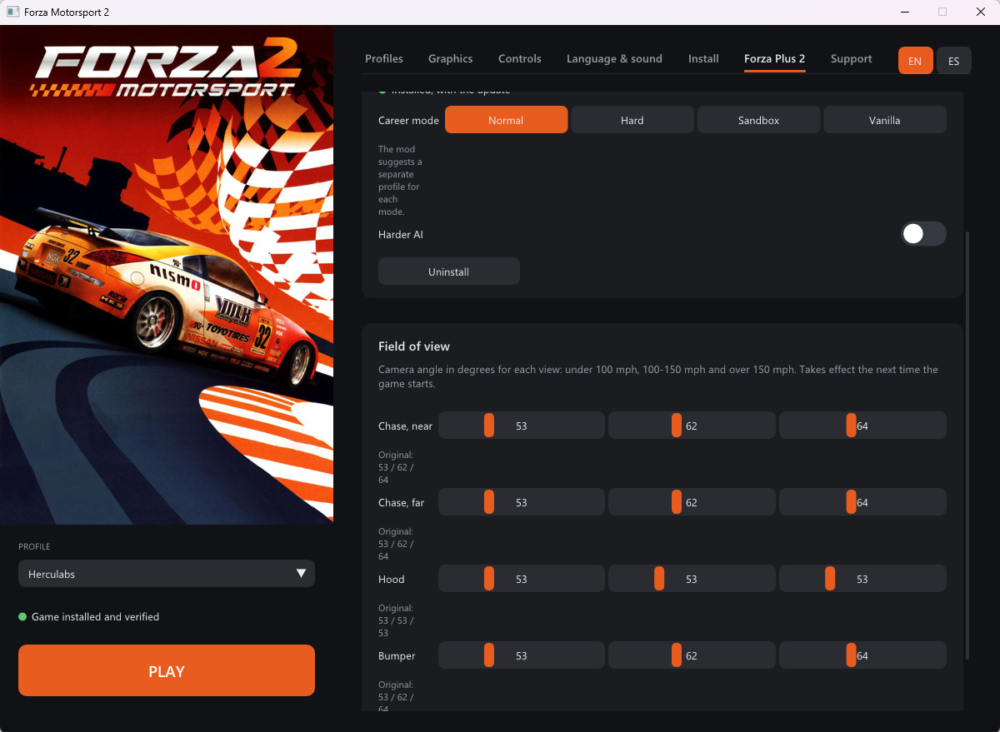

# Forza Motorsport 2 — Native PC Port

Play Forza Motorsport 2 (Xbox 360, 2007) natively on Windows. The game's
PowerPC code is statically recompiled ahead of time to C++ and compiled for
x86-64 — no CPU emulation, no JIT. Graphics run on Direct3D 12, audio is
decoded natively.

> **No game files are included.** You need your own original copy of
> Forza Motorsport 2 for Xbox 360 (a disc image, `.iso`).

**[⬇ Download the latest release](../../releases/latest)** ·
**[☕ Support on Ko-fi](https://ko-fi.com/post/Forza-Motorsport-2-native-on-PC-E2Q428PZ5Y)** ·
**[Changelog](CHANGELOG.md)**

<p align="center">
  
  
</p>
<p align="center">
  
  
</p>

---

## Requirements

- Windows 10 or 11, 64-bit
- A GPU with Direct3D 12 support
- About 5 GB of free disk space
- Your own Forza Motorsport 2 disc image (`.iso`), European or American
  release (title ID `4D5307EA`)

Nothing else needs installing: the Visual C++ runtime is bundled.

## Getting started

1. Download `Forza2-Native-<version>-windows-x64.zip` from
   [Releases](../../releases) and extract it to any folder.
2. Run **`Forza2Launcher.exe`**. It opens in English; press **ES** (top right)
   for Spanish.
3. Go to **Install** → **Choose ISO and import** and pick your disc image. The
   game is extracted to the `game\` folder and every file is checked against
   [`game_files.sha256`](launcher/data/game_files.sha256). It takes a minute
   or two. If the game is already extracted, use **Change folder** instead.
4. Go to **Profiles** and create your profile.
5. Press **PLAY**.

The first time you press PLAY, and after changing the internal resolution or
MSAA, the launcher prepares the shaders first (with a progress bar) and then
starts the game.

## The launcher

| Tab | What you can do |
|---|---|
| **Profiles** | Create, choose and delete profiles. Each profile has its own saves. |
| **Graphics** | Fullscreen or window, monitor, window size, refresh rate (60 or 120 Hz), quality presets (Original 720p / High 1440p / Ultra 4K), internal resolution, anisotropic filtering, MSAA, anti-aliasing and upscaling. |
| **Controls** | Controller or keyboard, mouse for the camera, and key remapping. |
| **Language & sound** | Game language (English, Español, Français, Deutsch, Italiano) and mute. |
| **Install** | Import the game from an ISO or choose its folder. Once installed: verify files, add the bonus disc DLC and prepare shaders. |
| **Forza Plus 2** | Install, update and remove the Project Forza Plus 2 mod, switch its career mode and AI, and set each camera's field of view. |
| **Support** | Link to the project's Ko-fi. |

Changes are saved automatically. The cover art is not shipped (it is
copyrighted artwork): put any `cover.png` next to `Forza2Launcher.exe` and it
fills the left column; without it the launcher draws its own panel.

<p align="center">
  
  
</p>

### Refresh rate

The game paces itself on the refresh rate chosen in **Graphics**: **60 Hz**
holds a steady 60 fps in races; **120 Hz** runs races at up to 120 fps and
needs a 120 Hz monitor and a fast CPU. Menus run at half the rate, as on the
Xbox 360. 144 Hz is not offered: at that rate races wait two refreshes per
frame and ran slower than at 60 Hz.

## Downloadable content (Limited Edition bonus disc)

The bonus disc of the Limited Edition carries the 8 premium DLC packs (car
packs, Road America and Motegi). With the game installed, go to **Install** →
**Downloadable content** → **Import bonus disc ISO**. The packs are copied
next to the game, and each profile installs them the next time it plays.

The disc's Title Update #4 is not used: it patches the game executable, and
the port runs the unpatched program.

## Project Forza Plus 2

The **Forza Plus 2** tab installs the community mod **Project Forza Plus 2**
straight from its release `.zip` files (not included; get them from the mod's
author). It needs the **American** release of the game.

1. Choose `Project Forza Plus 2 v1.3.zip`, pick a career mode and press
   **Install Project Forza Plus 2**.
2. Once it is installed, choose `Project Forza Plus 2 Update v1.3.zip` and
   press **Apply**.

From the same tab you can switch the career mode (Normal, Hard, Sandbox,
Vanilla), turn on the harder AI, set the field of view of the chase (near and
far), hood and bumper cameras for each speed range, and uninstall the mod. The
original files are kept, so uninstalling puts the game back exactly as it was.

The mod already includes the DLC cars and tracks, so the bonus disc packs are
not installed alongside it. The launcher also matches the mod's physics rate
(`CarPhysicsUpdateHz`) to the chosen refresh rate, as the mod's author asks.

## Controls

Any Xbox-compatible controller works without setup. Default keyboard layout:

| Action | Key |
|---|---|
| Accelerate | E |
| Brake | Q |
| Steer | A / D |
| Accept | Space |
| Back | Backspace |
| Start / pause | Enter |
| Camera | Arrow keys |

All keys can be changed in **Controls**.

## Where things are

| What | Where |
|---|---|
| Saves | `Documents\forza2\profiles\<profile>\` |
| Deleted profiles | `Documents\forza2\profiles-papelera\` |
| Shader cache | `Documents\forza2\cache\` |
| Settings | `forza2.user.toml`, next to the launcher |
| Error logs | `logs\`, next to the launcher (only kept when something goes wrong) |

## Known issues

- The first time you visit a track or see a new car you may notice some
  stutter while its shaders are compiled. After that they are prepared
  before you play.
- Career mode and split-screen are not fully tested; the DLC cars and tracks
  have only been tested briefly.
- A few UI sound banks are opened by relative path and do not load.
- DLC packs are installed under `Documents\forza2\profiles\<profile>\`. If
  that path is very long (a long user name or Documents synced to OneDrive),
  some packs may fail to install; the error is written to the log.
- Some antivirus engines flag the download with generic or heuristic
  detections. The file they point at is `rexruntime.dll`, the ReXGlue SDK
  runtime, shipped unchanged from the official release. The executables are
  not code-signed yet; each release lists the SHA-256 of its files.
- Xbox Live features are not available.

If the game closes with an error, the launcher tells you. Please open an
[issue](../../issues) and attach the file from the `logs\` folder.

---

## Building from source

Requires Visual Studio 2022 (or Build Tools) with the C++ workload, and LLVM:

```
winget install Microsoft.VisualStudio.2022.BuildTools --override "--add Microsoft.VisualStudio.Workload.VCTools --includeRecommended"
winget install LLVM.LLVM
build.bat release          :: or relwithdebinfo for symbolized crash reports
tools\package_release.ps1  :: builds dist\Forza2-Native-<version>-windows-x64.zip
```

`build.bat` downloads the [ReXGlue SDK](https://github.com/rexglue/rexglue-sdk)
v0.10.0 into `_sdk\` on first run. The recompiled code in `generated/` is
committed, so a clone builds without the game. To regenerate it, put your
`default.xex` in `assets\` and build again. `run.bat` starts the development
build against `assets\` and logs to `run.log`.

### Repository layout

| Path | Contents |
|---|---|
| [`forza2_manifest.toml`](forza2_manifest.toml) | `rexglue codegen` configuration: functions the analysis missed, fiber replacements, mid-function hooks |
| [`generated/`](generated) | The game's program code translated to C++ (machine-generated, committed) |
| [`src/`](src) | Port code on top of the recompiled game: app setup, profiles, DLC install, crash reports, fixes and diagnostics |
| [`launcher/`](launcher) | `Forza2Launcher` (SDL3 + Dear ImGui): profiles, settings, ISO import and verification, Project Forza Plus 2 |
| [`config/forza2.toml`](config/forza2.toml) | Runtime settings the game needs, shipped next to the exe |
| [`tools/`](tools) | Packaging, file manifest, scripted test sessions; [`tools/analysis/`](tools/analysis) has the disc/XEX scripts used to find what codegen missed |
| [`docs/`](docs) | Player notes (`PLAYERS.md`, shipped as `LEEME.md`), third-party notices, images |
| [`cmake/`](cmake), [`scripts/`](scripts) | Build helpers and the SDK download |

### How it was ported

| Piece | Where |
|---|---|
| PowerPC → C++ translation | `rexglue codegen`, driven by [`forza2_manifest.toml`](forza2_manifest.toml) |
| Functions the analysis missed (tail-called thunks, ~320 vtable-only functions merged into neighbours) | `[entrypoint.functions]` in the manifest, found with `tools/analysis/` scans |
| XAPI fibers (the title's job system) mapped to host fibers | `[entrypoint.rexcrt]` in the manifest |
| Profile name and per-profile saves | [`src/profile.cpp`](src/profile.cpp) |
| Bonus disc DLC installed into each profile | [`src/dlc.cpp`](src/dlc.cpp) |
| Null-stream crash while loading races | [`src/stream_guard.cpp`](src/stream_guard.cpp) |
| GPU log spam that cost frame rate | [`src/log_filter.cpp`](src/log_filter.cpp) |
| Guest call chain on crashes | [`src/crash_report.cpp`](src/crash_report.cpp) |

Every recompiled function is a weak `sub_<address>` that forwards to
`__imp__sub_<address>`, so any of them can be wrapped or replaced from `src/`.

The European (media ID `3E3180AE`) and American (`0DF2D3F6`) discs hold the
same program and the same data files; only the header of `default.xex`
differs, so the manifest accepts both hashes. Project Forza Plus 2 replaces
`default.xex` with the mod's copy, which only edits the table of file
signatures the game checks (resource `0D163575`); the code is the same.

## Support

If you enjoy the project and want it to keep improving, you can support it on
**[Ko-fi](https://ko-fi.com/post/Forza-Motorsport-2-native-on-PC-E2Q428PZ5Y)**.
Thank you! 🏁

## Legal

This repository contains no game assets: no executables, disc images,
textures, audio or video. `generated/` is a machine translation of the game's
program code; `game_files.sha256` holds only hashes. You must own the game to
use this port. Forza Motorsport is a trademark of Microsoft; this project is
not affiliated with or endorsed by Microsoft, Xbox Game Studios or Turn 10
Studios. Third-party licenses are in
[`docs/THIRD_PARTY_NOTICES.txt`](docs/THIRD_PARTY_NOTICES.txt), included in the
download.

## Credits

- [ReXGlue SDK](https://github.com/rexglue/rexglue-sdk) — recompiler and runtime
- [Xenia](https://github.com/xenia-project/xenia) — the emulation research ReXGlue builds on
- [XenonRecomp](https://github.com/hedge-dev/XenonRecomp) — static recompilation for Xbox 360
- [CrownParkComputing/Xbox360-Native-Ports](https://github.com/CrownParkComputing/Xbox360-Native-Ports) — the approach this port follows

---

### 🇪🇸 En español

Juega a Forza Motorsport 2 (Xbox 360) de forma nativa en Windows.
**No incluye archivos del juego**: necesitas tu propia copia original (`.iso`),
europea o americana.

1. Descarga el `.zip` de [Releases](../../releases) y descomprímelo.
2. Abre `Forza2Launcher.exe` y pulsa **ES** (arriba a la derecha) para ponerlo
   en castellano.
3. En **Instalación** → **Elegir ISO e importar**, elige tu imagen de disco.
4. En **Perfiles**, crea tu perfil.
5. Pulsa **JUGAR**.

- **Frecuencia**: en Gráficos, 60 Hz (60 FPS fijos en carrera) o 120 Hz
  (monitor de 120 Hz y CPU rápida).
- **DLC del disco extra de la edición limitada**: con el juego instalado, en
  **Instalación** → **Contenido descargable** → **Importar ISO del disco
  extra**. Cada perfil instala los 8 packs la próxima vez que juega.
- **Project Forza Plus 2** (solo versión americana): en la pestaña **Forza
  Plus 2**, instala el `.zip` del mod y después el de la actualización. Desde
  ahí se cambia el modo de trayectoria, la IA y el campo de visión de cada
  cámara, y se desinstala. El mod ya incluye los coches y circuitos DLC.

Requisitos: Windows 10/11 de 64 bits, GPU con Direct3D 12 y unos 5 GB libres.
Apoya el proyecto en
[Ko-fi](https://ko-fi.com/post/Forza-Motorsport-2-native-on-PC-E2Q428PZ5Y). ¡Gracias!
